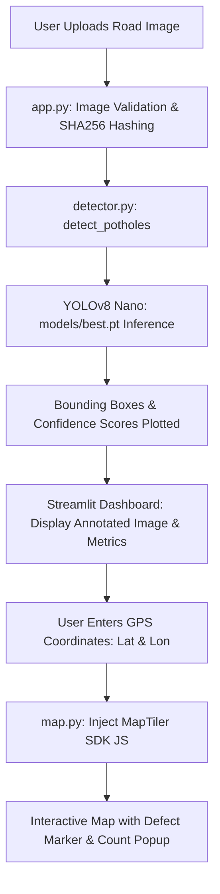

# 🚧 AI-Based Pothole Detection & Location Reporting System

An end-to-end Computer Vision and Geospatial reporting application that detects road potholes from uploaded images using a custom-trained **YOLOv8** model and plots their exact geographical coordinates on an interactive **MapTiler** map.

---

## 📌 Project Overview

Road safety and road infrastructure maintenance suffer from slow, manual pothole reporting. This project provides an automated, intelligent solution:
1. **Pothole Detection**: Users upload road imagery; a lightweight YOLOv8 Nano model pinpoints pothole instances with bounding boxes and confidence scores.
2. **Geographical Reporting**: Allows road inspectors and citizens to tag GPS coordinates (Latitude & Longitude) for road defects.
3. **Interactive Visual Mapping**: Renders dynamic, vector-based interactive maps with English labels and defect counts using the MapTiler SDK.

---

## 🛠️ Frameworks, Libraries & Tools

| Component | Framework / Tool | Role & Task Description |
| :--- | :--- | :--- |
| **Deep Learning** | `ultralytics` (YOLOv8) | Object detection model architecture, transfer learning, inference, and visualization (`.plot()`). |
| **ML Backend** | `PyTorch` | Underlying tensor operations, neural network layers, and CPU/GPU execution. |
| **Image Processing** | `OpenCV (opencv-python)` | Color channel adjustments (BGR to RGB) and spatial image processing. |
| **Image Handling** | `Pillow (PIL)` | Loading, formatting, and rendering image streams in memory. |
| **Web Frontend** | `Streamlit` | Web UI framework providing file uploaders, sidebar threshold controls, session state management, and real-time metric rendering. |
| **Geospatial Mapping** | `MapTiler SDK JS` (`maptiler-sdk-js v4.2.1`) | Embedded via `streamlit.components.v1` to display vector street maps with custom marker pins and popup info. |
| **Geospatial Helpers**| `folium` / `streamlit-folium` | Python geospatial mapping libraries included for extended spatial analysis. |
| **Data & Hashing** | `NumPy`, `Pandas`, `hashlib` | Tensor conversions, evaluation log processing, and image hash generation to optimize state caching. |

---

## 📂 Project Structure

```text
Pothole_Detection/
├── .streamlit/
│   ├── secrets.toml          # (Ignored) Private API keys for MapTiler
│   └── secrets.toml.example  # Template for required environment secrets
├── data/
│   └── pothole_dataset/
│       └── extracted/
│           ├── data.yaml     # Dataset configuration (train/val/test paths & class labels)
│           ├── README.dataset.txt
│           └── README.roboflow.txt
├── models/
│   └── best.pt               # Trained YOLOv8 fine-tuned weights (6.47 MB)
├── sample_images/            # Sample road images for quick testing
│   ├── sample_pothole_1.jpg
│   ├── sample_pothole_2.jpg
│   └── sample_pothole_3.jpg
├── uploads/                  # Temporary cache for user uploads
├── .gitignore                # Excludes virtual environments, datasets, and secrets
├── app.py                    # Streamlit web application entry point
├── detector.py               # Core YOLO inference pipeline function
├── evaluate.py               # Model validation and metric evaluation script
├── map.py                    # MapTiler integration module for map visualization
├── requirements.txt          # Python dependencies
├── train.py                  # Model training script
└── yolov8n.pt                # Base pretrained YOLOv8 Nano weights
```

---

## ⚙️ How It Works (End-to-End Workflow)



1. **Upload & Caching**: The user uploads an image (`.jpg`, `.jpeg`, `.png`). `app.py` hashes the image bytes using `hashlib.sha256` to ensure results are re-evaluated only when a new image is provided.
2. **Detection & Confidence Thresholding**: `detector.py` invokes `models/best.pt` with the confidence threshold selected on the sidebar slider (default: `0.25`).
3. **Bounding Box Visualization**: YOLOv8 predicts bounding boxes (`box.xyxy`) and confidence values. The annotated image is rendered with side-by-side metric cards.
4. **Coordinate Tagging & Mapping**: The user provides GPS coordinates where the photo was taken. `map.py` injects an HTML/JS container running MapTiler SDK with an English street style, dropping a high-visibility marker with detection metadata.

---

## 📊 Model Training & Evaluation

- **Base Architecture**: YOLOv8 Nano (`yolov8n.pt`)
- **Dataset**: Roboflow Pothole Dataset (1,434 annotated images split across train, validation, and test sets).
- **Training Parameters**:
  - Image size: `416x416`
  - Epochs: `20`
  - Batch size: `4`
  - Device: `CPU`
  - Optimizer patience: `5`
- **Performance Metrics**:
  - Precision: ~`63.8%`
  - Recall: ~`55.5%`
  - mAP@50: ~`56.4%`
  - Best weights saved to `models/best.pt`.

---

## 🚀 Getting Started

### 1. Clone the Repository
```bash
git clone https://github.com/logendraprabhu/Pothole_Detection.git
cd Pothole_Detection
```

### 2. Set Up Virtual Environment & Dependencies
```bash
python -m venv .venv
# Windows:
.venv\Scripts\activate
# Linux/macOS:
source .venv/bin/activate

pip install -r requirements.txt
```

### 3. Configure MapTiler API Key
Create a `.streamlit/secrets.toml` file based on `.streamlit/secrets.toml.example`:
```toml
MAPTILER_API_KEY = "your_maptiler_api_key_here"
```
*(Get a free key at [MapTiler Cloud](https://cloud.maptiler.com/))*

### 4. Run the Streamlit Application
```bash
streamlit run app.py
```
Open your browser at `http://localhost:8501`.

---

## 🔬 Scripts Execution

- **Retrain the Model**:
  ```bash
  python train.py
  ```
- **Evaluate Model on Test Split**:
  ```bash
  python evaluate.py
  ```
